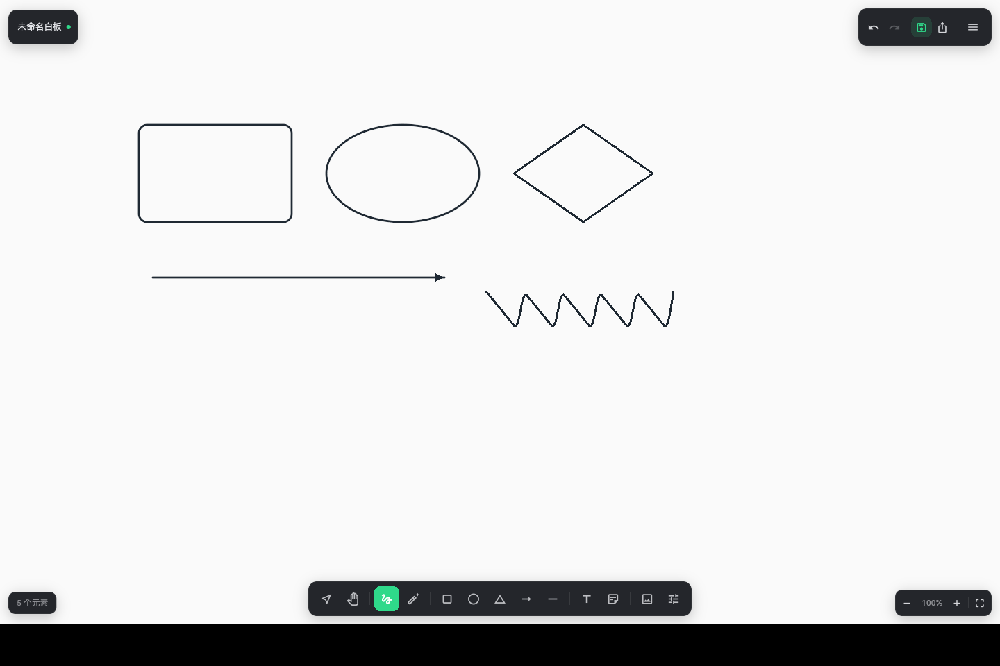

# wb-pro

跨平台无限画布白板。手绘、形状、箭头、文本、便签和图片落在同一块没有边界的画布上，文档保存为自包含的 `.wbpro`，也可以导出 PNG 或可直接在 Figma / Illustrator 里继续编辑的 SVG。

同一套 Flutter 代码构建 Windows、macOS、Linux 与 Android 四个平台，安装包由 GitHub Actions 在每次推送时产出。



## 特性

**画布**
- 无限画布，滚轮/双指平移，Ctrl+滚轮以光标为锚点缩放（0.05×–8×）
- 点阵网格，可调间距，可选吸附
- 触屏与鼠标同时支持：单指绘制、双指缩放平移、空格或中键临时抓手

**绘制**
- 画笔：中点二次贝塞尔平滑，采样按缩放去重
- 形状：矩形（可调圆角）、椭圆、菱形，Shift 约束为正方形
- 箭头与直线，支持实线 / 虚线 / 点线
- 文本：字号、加粗、斜体、左中右对齐，双击进入行内编辑
- 便签：六种底色，直接在画布上写
- 图片：内嵌进文档，换机器不会丢

**编辑**
- 选择、框选、多选（Shift 叠加）
- 移动、八向缩放、旋转（Shift 按 15° 步进）
- 层级：置顶 / 上移 / 下移 / 置底
- 对齐与等距分布（≥3 个元素）
- 100 步撤销/重做，剪贴板跨窗口复制粘贴

**文件**
- `.wbpro`：单个 JSON，图片以 base64 内嵌，换机不丢素材
- 导出 PNG（2× 像素密度，超大画布自动降采样）
- 导出 SVG（路径、文本、图片都是原生 SVG 元素，不是位图套壳）
- 每 2 秒静默自动保存，崩溃或误关后可恢复

## 下载

到 [Releases](../../releases) 取对应平台的包：

| 平台 | 产物 | 说明 |
| --- | --- | --- |
| Windows | `wb-pro-windows-x64.zip` | 解压后运行 `wb_pro.exe` |
| macOS | `wb-pro-macos-x64.zip` | x86_64 构建；未签名，首次打开需右键 → 打开 |
| Linux | `wb-pro-linux-x64.tar.gz` | 解压后运行 `bundle/wb_pro`，需要 GTK 3 |
| Android | `app-release.apk` / `.aab` | release 包使用 debug 签名，可直接侧载 |

## 从源码运行

需要 Flutter 3.27 或更新版本（CI 使用 3.47.9）。

```bash
flutter pub get
flutter run -d linux      # 或 windows / macos
flutter build linux --release
```

国内网络可以加镜像：

```bash
export PUB_HOSTED_URL=https://pub.flutter-io.cn
export FLUTTER_STORAGE_BASE_URL=https://storage.flutter-io.cn
```

### 测试

```bash
flutter analyze
flutter test
```

154 个用例覆盖几何计算、视口变换、撤销栈、元素序列化、文档容错、SVG 输出、PNG 像素尺寸、控制器规则与主界面交互。

## 快捷键

| 操作 | 快捷键 |
| --- | --- |
| 选择 / 抓手 / 画笔 / 橡皮 | `V` `H` `P` `E` |
| 矩形 / 椭圆 / 菱形 / 箭头 / 直线 | `R` `O` `D` `A` `L` |
| 文本 / 便签 | `T` `N` |
| 撤销 / 重做 | `Ctrl+Z` / `Ctrl+Shift+Z`、`Ctrl+Y` |
| 复制 / 剪切 / 粘贴 / 副本 | `Ctrl+C` `Ctrl+X` `Ctrl+V` `Ctrl+D` |
| 全选 / 删除 | `Ctrl+A` / `Delete` |
| 微移 | 方向键（`Shift` 为 10px） |
| 层级 | `Ctrl+]` `Ctrl+[`，加 `Shift` 置顶 / 置底 |
| 新建 / 打开 / 保存 / 另存为 | `Ctrl+N` `Ctrl+O` `Ctrl+S` `Ctrl+Shift+S` |
| 导出 PNG | `Ctrl+E` |
| 放大 / 缩小 / 实际大小 | `Ctrl+=` `Ctrl+-` `Ctrl+0` |
| 适应内容 | `Shift+1` |
| 网格 / 吸附 | `Ctrl+G` / `Ctrl+Shift+G` |
| 快捷键面板 | `?` |

画布内还有：空格拖动平移、中键拖动平移、Shift 拖拽约束比例、Shift 旋转吸附 15°。macOS 上 `Ctrl` 与 `Command` 等价。

## 文件格式

`.wbpro` 是一个 UTF-8 JSON：

```json
{
  "format": "wb-pro",
  "version": 1,
  "name": "架构草图",
  "createdAt": "2026-10-30T09:00:00.000Z",
  "modifiedAt": "2026-10-30T09:42:11.000Z",
  "viewport": { "panX": -320.5, "panY": -180, "zoom": 1.25 },
  "elements": [
    {
      "type": "shape",
      "id": "el-m8x2k1-3f9a",
      "x": 120, "y": 80, "w": 240, "h": 120,
      "shape": "rectangle",
      "stroke": 4281018675,
      "fill": 4294961766,
      "width": 3,
      "style": "solid",
      "radius": 12
    }
  ]
}
```

颜色是 `0xAARRGGBB` 的十进制整数。元素的 `x/y/w/h` 是**未旋转**的轴对齐框，`rotation` 绕框中心生效；笔迹点和箭头端点存的是相对框左上角的本地坐标，所以平移元素只需要改 `frame`。

读取时任何单个元素坏掉都只会被跳过并给出提示，不会让整份文档打不开。

## 项目结构

```
lib/
  model/       geometry.dart  点到线段距离、旋转、包围盒
               element.dart   六种元素的不可变模型 + JSON 编解码
               text_metrics.dart
  state/       viewport.dart  世界坐标 ↔ 屏幕坐标
               history.dart   快照式撤销栈
               editor_controller.dart  全部编辑规则
  render/      painting.dart  元素绘制、虚线、箭头、网格、图片缓存
  ui/          canvas_view.dart  手势与选择框
               home_page.dart   布局与动作编排
               inspector_panel.dart / tool_rail.dart / top_bar.dart / status_bar.dart
               text_overlay.dart  行内文本编辑
  io/          document.dart  .wbpro 编解码
               document_store.dart  系统文件对话框、自动保存
               export_png.dart / export_svg.dart
```

## 设计说明

**状态和界面完全分开。** `EditorController` 不 import 任何 Widget，鼠标、键盘、对话框都在 UI 层。代价是画布要自己算坐标，收益是所有编辑规则都能在纯 Dart 测试里跑——对齐、层级、吸附这些最容易写错又最难手点验证的逻辑，现在有 60 多个用例盯着。

**撤销存整条列表。** 元素是不可变的，改一个元素就是换一条列表（其余元素结构共享），所以 100 步历史只占几百 KB；每步深拷贝整棵场景会到几百 MB。

**虚线自己切。** Flutter 的 `Paint` 没有 `dashPattern`，只能用 `Path.computeMetrics()` 按长度逐段提取。好处是曲线段也能切得均匀。

**SVG 导出不用第三方库。** 导出是单向的，六种元素的翻译规则自己写反而更可控，也能保证和画布渲染用同一套几何（虚线长度、箭头夹角、贝塞尔控制点），不会出现「画布上是曲线、导出成折线」。

**文本编辑是浮层不是弹窗。** 编辑便签时要能看见周围内容，才知道这段话放不放得下。

## 已知限制

- **文本排版依赖系统字体。** 没有内置字体，同一段文字在 Windows（Segoe UI）和 Android（Roboto/思源）上的换行位置可能差一两个字符。自由布局的白板可以接受，排版工具不行。
- **SVG 里的字体只是「建议」。** 在没有同款字体的机器上打开会回退，字形宽度会变。需要绝对一致的场合请导出 PNG。
- **macOS 包未签名/未公证**，首次打开会被 Gatekeeper 拦。
- **Android release 用 debug 签名**，仅适合侧载，不能上架。
- **图片以 base64 内嵌**，一张 5MB 的照片会让文档膨胀到 6.7MB。这是「一个文件走天下」的代价。

## 许可

[MIT](LICENSE)
